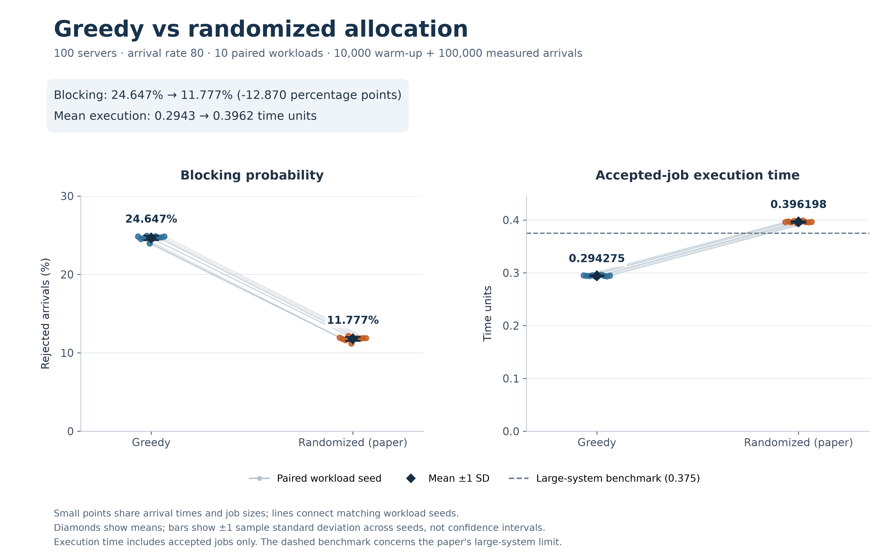

# M7: Greedy versus the paper's randomized policy

At 100 servers, greedy blocked **24.647%** of arrivals and randomized blocked **11.777%**. Mean accepted-job execution time was **0.294275** and **0.396198** time units, respectively.

## Policy and experiment

- Greedy targets 5 servers. The paper's greedy(p*) targets 3 with probability 0.625 and 4 with probability 0.375. Both allocate the smaller of target and idle capacity, reject only when no server is idle, and keep allocations until completion.
- These probabilities apply to normalized rate 0.8, mean inherent job size 1, and speedups (1, 1.8, 2.5, 3, 3.4). From the paper's optimal state, y3=0.2 and y4=0.1: p3=2.5*0.2/0.8=0.625 and p4=3*0.1/0.8=0.375.
- 100 servers, Poisson arrival rate 80, exponential inherent job sizes with mean 1.
- Baseline: 10,000 warm-up arrivals and 100,000 measured arrivals per workload seed.
- Workload seeds 0-9. Each pair uses exactly the same arrival times and sizes; matching SHA256 fingerprints are checked before computing paired differences.
- Policy seeds are 10,000 plus the workload seed. Policy randomness has its own generator. A target is drawn for every arrival, including warm-up and blocked jobs.
- Every run starts from an empty system with a fresh policy stream. Warm-up allocations remain active, and measured accepted jobs contribute their full durations.
- Server and job conservation checks remain enabled. All accepted jobs finish.

## Baseline comparison

Means weight the ten runs equally. SD is sample standard deviation across runs, not a confidence interval.

| Policy | Runs | Blocking mean | Blocking SD | Execution mean | Execution SD |
| --- | ---: | ---: | ---: | ---: | ---: |
| greedy | 10 | 0.246470 | 0.002799 | 0.294275 | 0.001011 |
| randomized | 10 | 0.117771 | 0.002496 | 0.396198 | 0.001476 |

## Paired policy differences

Each difference is randomized minus greedy on the same workload. The SD describes variation in these matched differences across seeds.

| Metric | Mean difference | Difference SD |
| --- | ---: | ---: |
| Blocking probability | -0.128699 | 0.001035 |
| Mean execution time | +0.101923 | 0.000735 |

Blocking changed by -12.870 percentage points (-52.22% relative to greedy). Accepted-job execution time changed by +0.101923 time units (+34.64% relative).

## Randomized policy sensitivity

The new policy receives its own warm-up and run-length checks. The same six configurations and ten seeds as M6 are used. The baseline randomized runs are shared with the main policy comparison.

| Warm-up | Measured | Runs | Blocking mean | Blocking SD | Execution mean | Execution SD |
| ---: | ---: | ---: | ---: | ---: | ---: | ---: |
| 1,000 | 100,000 | 10 | 0.117358 | 0.003364 | 0.396014 | 0.002020 |
| 5,000 | 100,000 | 10 | 0.117349 | 0.002905 | 0.396035 | 0.001743 |
| 10,000 | 10,000 | 10 | 0.118580 | 0.005190 | 0.395606 | 0.003433 |
| 10,000 | 50,000 | 10 | 0.118072 | 0.004920 | 0.395758 | 0.001864 |
| 10,000 | 100,000 | 10 | 0.117771 | 0.002496 | 0.396198 | 0.001476 |
| 10,000 | 200,000 | 10 | 0.117735 | 0.001555 | 0.396645 | 0.000773 |

The following deltas compare randomized configurations with the randomized baseline, pairing the same workload and policy seeds.

| Warm-up | Measured | Blocking mean delta | Blocking delta SD | Execution mean delta | Execution delta SD |
| ---: | ---: | ---: | ---: | ---: | ---: |
| 1,000 | 100,000 | -0.000413 | 0.001543 | -0.000183 | 0.000730 |
| 5,000 | 100,000 | -0.000422 | 0.000991 | -0.000163 | 0.000556 |
| 10,000 | 10,000 | +0.000809 | 0.004488 | -0.000591 | 0.003386 |
| 10,000 | 50,000 | +0.000301 | 0.002862 | -0.000440 | 0.000762 |
| 10,000 | 200,000 | -0.000036 | 0.001998 | +0.000448 | 0.001143 |

As in M6, the exploratory tolerances are 0.002 probability (0.2 percentage points) and 0.002 time units for changes in configuration means. They are practical thresholds, not significance tests. Checks cover shorter warm-ups at a fixed measured length and doubling the measured length.

The checked changes are within these tolerances, supporting the same initial measurement settings for both policies.

## Interpretation and scope

The comparison measures the tradeoff between admission and accepted-job speed. Rejected jobs contribute to blocking but have no execution-time observation. The two policies can accept different subsets of the shared workload.

For these parameters the paper's large-system execution benchmark is 0.625/2.5 + 0.375/3 = 0.375 time units, with blocking tending to zero as server count grows. Partial allocations can lengthen executions at finite size. This experiment uses n=100 and does not establish asymptotic optimality or guarantee zero blocking. More seeds or longer runs may be needed for tighter precision.

Reference: Mukhopadhyay et al., *On Optimal Server Allocation for a Loss System With Moldable Jobs*, Sections IV and VII. [DOI](https://doi.org/10.1109/TON.2025.3598595).

## Reproduce

```bash
.venv/bin/python run_comparison.py
```

[Complete results](../results/policy_comparison.json) include every run, workload fingerprints, both seeds, allocation counts, summaries, and paired differences. The source text and SHA256 hashes are embedded for reproducibility. Python used: 3.14.0.

Optional figure (after installing requirements-plot.txt):

```bash
.venv/bin/python plot_comparison.py
```


