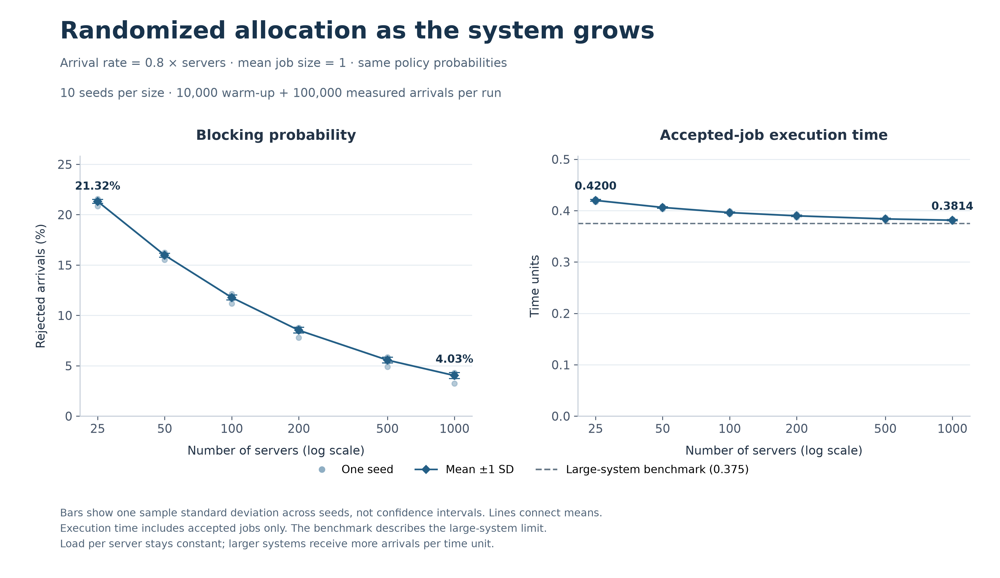

# Randomized policy: different server counts

Compare system sizes while keeping the offered load per server constant.

From 25 to 1,000 servers, blocking changes from **21.316%** to **4.032%**. Mean accepted-job execution time changes from **0.419964** to **0.381355** time units.

## Settings

- RandomizedPolicy targets 3 servers with probability 0.625 and 4 with probability 0.375; allocate the smaller of target and idle capacity.
- Arrival rate is 0.8 times the server count. Mean exponential job size stays at 1. The normalized load, arrival_rate * mean_job_size / servers, stays at 0.8. This is offered load, not measured utilization. The policy probabilities remain applicable.
- Speedups stay at (1, 1.8, 2.5, 3, 3.4); each job still has a maximum of 5 servers.
- Each size uses 10 workload seeds, 10,000 warm-up arrivals and 100,000 measured arrivals per seed.
- Reuse workload seeds 0-9 and separate policy seeds 10000-10009 across sizes. This shares random draws and job sizes; arrival timestamps change with arrival rate. Different seeds give independent replications; sizes sharing a seed are correlated.
- Start each run empty, retain active warm-up jobs at the measurement cutoff, and drain all accepted jobs after the final arrival. Conservation checks remain enabled.

## Results

Means weight the ten runs equally. SD is sample standard deviation across seeds, not a confidence interval. Execution times include accepted jobs only.

| Servers | Arrival rate | Blocking mean | Blocking SD | Execution mean | Execution SD |
| ---: | ---: | ---: | ---: | ---: | ---: |
| 25 | 20 | 21.316% | 0.001980 | 0.419964 | 0.001891 |
| 50 | 40 | 15.975% | 0.001938 | 0.406244 | 0.001567 |
| 100 | 80 | 11.777% | 0.002496 | 0.396198 | 0.001476 |
| 200 | 160 | 8.527% | 0.002857 | 0.389935 | 0.001683 |
| 500 | 400 | 5.566% | 0.002721 | 0.383900 | 0.001280 |
| 1,000 | 800 | 4.032% | 0.003039 | 0.381355 | 0.001302 |



## Interpretation

Increasing the arrival rate with capacity asks whether a larger system performs differently at the same offered load per server. Keeping arrival rate fixed would instead make larger systems progressively less loaded.

The paper's large-system execution benchmark for these parameters is 0.375 time units, with blocking tending to zero as server count grows. Finite simulations can illustrate the trend but cannot prove that limit. Partial allocations can increase execution time, and different sizes can accept different subsets of jobs.

The warm-up and measurement counts come from the 100-server experiment. They have not been separately validated at every size. Because arrival rate increases, the same arrival count spans less simulated time in larger systems; treat this as an exploratory comparison.

Reference: Mukhopadhyay et al., *On Optimal Server Allocation for a Loss System With Moldable Jobs*. [DOI](https://doi.org/10.1109/TON.2025.3598595).

## Reproduce

```bash
.venv/bin/python run_server_experiment.py

# Optional figure; install requirements-plot.txt first.
.venv/bin/python plot_server_experiment.py
```

[Complete results](../results/randomized_servers.json) contain each run, settings, both seeds, allocation counts, workload fingerprints, summaries and source snapshots. Python used: 3.14.0.
